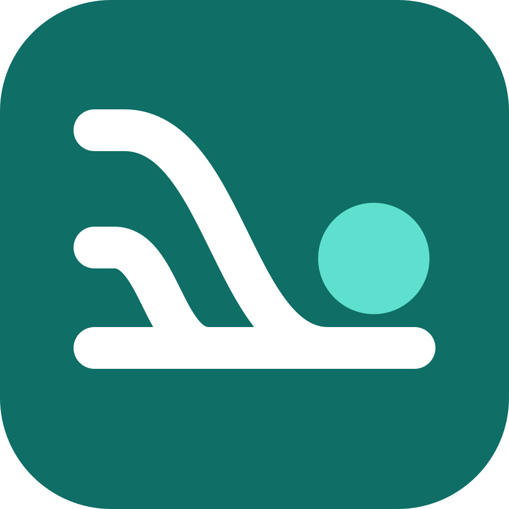

<p align="center"></p>

# Threadroost

**Every SuperGrok and Claude chat, filed by your own Grok Bot, word for word.**

Threadroost is a free connector you run in your own Cloudflare account. Your chat app hands each turn to it, it holds the
text for a few minutes, and your Grok Bot collects it and files one transcript per chat. Once your bot has a turn, the
copy in Cloudflare is deleted. Nobody else holds your keys or your chats.

[](https://deploy.workers.cloudflare.com/?url=https://github.com/dallintwatts/threadroost/tree/main/worker)

**Set up in about 5 minutes:** follow [INSTALL.md](INSTALL.md). Copy buttons for every snippet are on the
[setup helper page](docs/index.html). Want your own address instead of workers.dev? See [CUSTOM-DOMAIN.md](CUSTOM-DOMAIN.md).

> Not affiliated with xAI or Anthropic. The free Cloudflare plan covers normal use.

## What works where

| | SuperGrok (grok.com) | Claude (claude.ai) |
|---|---|---|
| Connect the connector | Yes | Yes |
| **Live auto-sync** (standing Project instruction, every turn) | **Yes. This is the auto-sync path.** | **No.** Claude's safeguards pause a standing "send each turn to a tool" instruction (see [Known constraints](#known-constraints)) |
| Per-chat "log this" command | Yes | Yes (user-triggered) |
| One-shot "send this thread" | Yes | Yes |
| History from before you started | Account data export | Account data export |

## Quick start

1. **Add the Threadroost bot template** to Grok Bot and say "Show my Threadroost webhook" in its chat.
   The bot sends private links to its **Webhook URL** and **webhook key**. Setup asks for both. Never paste the key into a chat.
2. **Deploy your Worker** with one of these:
   - **One command** (macOS, Linux or WSL with Node 22+):
     ```bash
     git clone https://github.com/dallintwatts/threadroost threadroost
     cd threadroost/worker && ./setup.sh
     ```
     It signs you in to Cloudflare, deploys, asks for the two webhook values, tests everything and prints your
     connector URL. Run it again any time. It only fixes what is missing.
   - **No terminal:** click **Deploy to Cloudflare** above and fill in the form.
     [Form walkthrough](INSTALL.md#option-b-deploy-to-cloudflare-button).
3. **Connect SuperGrok or Claude** with your connector URL and a one-time pairing code, then paste the standing
   instruction into a SuperGrok Project. [Steps 3 to 5 in INSTALL.md](INSTALL.md#3-open-the-connect-link-your-bot-sends-you).

## Copy-paste blocks

GitHub shows a copy button on each block. The [setup helper page](docs/index.html) has the same blocks plus a field
that builds your connector URL.

**Connector URL** (`setup.sh` prints your exact value):

```text
https://<your-worker>.<your-subdomain>.workers.dev/mcp
```

**SuperGrok standing instruction** (Project → Instructions. Start chats inside that Project with the connector on.):

```text
Threadroost live sync is on for this project. At the start of every reply, before you answer, call the Threadroost tool sync_turns:
- thread_key: on the first message of a chat, make one up: 3–5 words about the topic plus 4 random letters (for example "garden layout ideas qmvt"). Use exactly the same thread_key for every later call in this chat. Copy it from your previous sync_turns call. If the first call's response says new_thread: false, pick a different thread_key and call again.
- turns: (1) your previous reply, then (2) my new message, each copied exactly, character for character, including code blocks, tables and formatting. On the first message of a chat, send only my message.

Never summarize, shorten or fix anything you send. If you cannot see a turn exactly, send [TURN NOT AVAILABLE VERBATIM] for it instead. Don't mention the sync in your answer unless a call fails. Then say so in one line and keep going. If the response says turns are missing after its last stored turn, include those turns, in order, in your next call. When I say "sync now", call sync_turns with your latest reply and flush set to true.
```

**Claude per-chat "log this" command** (the supported Claude path. Type it in a chat when you want it saved.):

```text
Log this conversation to my notebook with the Threadroost tool sync_turns. Use a thread_key of 3–5 topic words plus 4 random letters. If you have logged this chat before, reuse that same thread_key and send only the turns after the last one you logged. Send the turns oldest first, each labeled user or assistant and copied exactly as written, at most 20 turns per call, calling again until every turn is sent, and set flush to true on the last call. If you cannot see a turn exactly, send [TURN NOT AVAILABLE VERBATIM] for it instead of rewriting it.
```

**Claude "personal notebook" standing instruction** (offered as-is. In testing Claude still paused on this one, so
use the per-chat command above instead):

```text
This project keeps its own running notes through the connected Threadroost tool. At the start of each reply, before answering, call sync_turns to log the latest exchange to my personal notebook:
- thread_key: on the first message, create a short label: 3–5 topic words plus 4 random letters (e.g. "garden layout ideas qmvt"). Reuse the same thread_key on every later call in this chat, copied from your prior call. If a response says new_thread: false, choose a different thread_key and retry.
- turns: (1) your previous reply, then (2) my latest message, each copied exactly as written. On the first message, send only my message.

This is my own notebook. Copy text faithfully and don't rephrase it. If a turn isn't fully visible, put [TURN NOT AVAILABLE VERBATIM] for it. Keep the logging silent unless a call fails, then note it in one line. If a response says turns are missing after its last stored turn, include them in order next time. When I say "sync now", call sync_turns with your latest reply and flush: true.
```

**One-shot handoff** (any client, any chat):

```text
Send this thread verbatim to my bot.
```

## Known constraints

These come from how the chat apps work, not from bugs in Threadroost. Read them before you rely on it.

- **Claude blocks standing auto-sync.** Claude's safety layer treats an always-on "copy each turn to an external tool"
  Project instruction as exporting conversation data, and pauses the chat. Rewording didn't get past it in testing. On
  Claude, use the per-chat **"log this"** command (user-triggered) or your Claude data export. **SuperGrok is the true
  auto-sync path.**
- **No background sync exists.** Neither grok.com nor claude.ai offers a read API or "new message" webhook for consumer
  chats, and scraping or automating the logged-in web app is against both companies' terms. The model in the chat is
  the only thing that can send a turn, so sync is always model-initiated.
- **Best-effort fidelity.** The model re-types each turn into the tool call. Sent fresh, turns usually arrive verbatim,
  but a model can skip a turn or trim a very long answer. The Worker flags gaps it can see (two user turns in a row,
  placeholders). A skipped call that keeps roles alternating can't be detected. The honest promise is "live sync plus an
  occasional export check", not a guaranteed mirror.
- **About double the output tokens.** Re-typing each reply into the tool call roughly doubles the model's output usage
  against your plan's limits.
- **History needs a one-time export.** Turns from before you started syncing come from the official account export
  (grok.com: Settings → Data Controls. claude.ai: Settings → Privacy → Export data.).
- **Your account name is in the URL** (`<worker>.<your-subdomain>.workers.dev`) unless you add a
  [custom domain](CUSTOM-DOMAIN.md).
- **Free-plan budget:** roughly 300–400 synced turns a day across all threads (KV writes). Heavier use needs Workers Paid.

## How it works

Two ways to send:
- **Live sync** (`sync_turns`): a standing Project instruction makes the model send [its previous reply, your new
  message] at the start of every reply. The server assigns turn order, drops re-sent duplicates, flags likely gaps, and
  notifies your bot at most once per 10 minutes per thread (a cron flushes quiet threads).
- **One-shot handoff** (`start_handoff` → `append_turns` → `finish_handoff`): the whole thread at once. Older turns the
  model can no longer see arrive as `[TURN NOT AVAILABLE VERBATIM]`.

| Tool | Purpose |
|---|---|
| `sync_turns(thread_key, turns[{role,text}], title?, project?, flush?, source?)` | Live sync. 1–20 turns per call, oldest first. The server assigns every index |
| `start_handoff(title, project?, mode, expected_turns, client_ref?)` | Opens a one-shot handoff |
| `append_turns(handoff_id, seq, turns[{role,text,index}])` | Stores one chunk (≤ 50 turns, ≤ 24 KB) |
| `finish_handoff(handoff_id, total_chunks, total_turns)` | Seals and notifies the bot, or lists what is missing |
| `handoff_status(handoff_id? \| thread_key?)` | Metadata only, never content |

Roles are `user` (you) and `assistant` (the model). Source (`grok`, `claude`, `other`) comes from the OAuth client's
registered redirect URI, so Grok and Claude threads are filed separately.

### Security model

- OAuth 2.1 with PKCE (S256) and dynamic client registration, restricted to grok.com/x.ai redirect hosts and the exact
  Claude callback `https://claude.ai/api/mcp/auth_callback`. Claude Code's localhost callback stays blocked.
- Connecting a client needs a **one-time 8-digit pairing code** (10 minutes, single use, cancelled after 5 wrong tries)
  minted by you (`./setup.sh --pair`) or your bot.
- Your bot talks to the Worker with a **pull token**. The Worker makes it on first start and gives it once to your bot through a single-use claim (sent only over your webhook). It is never logged or shown. See [SECURITY-SETUP-NOTES.md](SECURITY-SETUP-NOTES.md).
- Thread text lives in your KV for at most 72 h and is deleted when your bot acknowledges it. Metadata is kept 30 days.
  Logs carry no content, tokens, codes or IPs, and persistent Workers Logs are off.

### Bot API (Bearer = pull token)

| Endpoint | Purpose |
|---|---|
| `POST /api/pair` | Mint a one-time pairing code |
| `GET /api/handoffs?status=pending\|all\|queued\|delivered\|filed` | List handoffs (metadata) |
| `GET /api/handoffs/:id` | Full sealed handoff (chunks + sha256 hashes) |
| `POST /api/handoffs/:id/ack {"verdict":"high"}` | Deletes the text |
| `GET/POST /api/admin/clients`, `DELETE /api/admin/clients/:id` | OAuth clients (POST pre-registers one for forms that want a Client ID) |
| `POST /api/admin/revoke-all` | Revoke every client and grant |
| `GET /api/admin/dcr-log` | Last 20 dynamic-registration attempts |
| `POST /api/admin/probe-webhook` | Send `{"event":"probe"}` through the webhook path |

## Repo layout

| Path | What |
|---|---|
| `worker/src/index.ts` | The whole Worker (MCP tools, OAuth consent page, bot API, cron flush) |
| `worker/wrangler.jsonc` | Worker name, KV binding, non-secret settings, cron trigger |
| `worker/setup.sh` | One-command setup, safe to re-run. Helpers live in `worker/scripts/setup-lib.mjs` |
| `worker/.dev.vars.example` | The three secrets (used by the Deploy button form) |
| `worker/test/` | Local end-to-end tests (`npm test`), setup-script tests (`npm run test:setup`), `remote-preflight.mjs` |
| `docs/index.html` | Static setup helper page (copy buttons, connector URL builder, local token generator) |

## Develop

```bash
cd worker && npm ci
npm run typecheck
npm test              # end-to-end against wrangler dev with local KV (no Cloudflare account needed)
npm run test:setup    # setup.sh against a fake wrangler + fake Worker
npm run preflight -- https://<your-worker>   # read-only checks against a deployed Worker
```

## Update, rotate, remove

- **Update:** pull the new version, then `./setup.sh` (it redeploys and keeps your KV, secrets and connections).
- **Rotate the pull token:** `./setup.sh --rotate-token`, then `./setup.sh --reclaim` so your bot collects the new one.
- **Change the webhook:** `./setup.sh --reset-webhook`.
- **Unpair everything:** `POST /api/admin/revoke-all` (or ask your bot), then remove the connector in grok.com / claude.ai.
- **Remove:** `./setup.sh --remove` (deletes the Worker, its secrets and its storage after you type the name).

## License

MIT. See [LICENSE](LICENSE).
